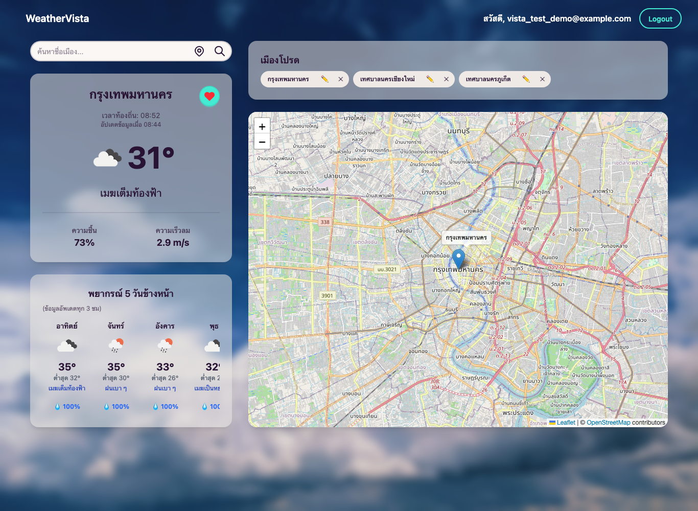
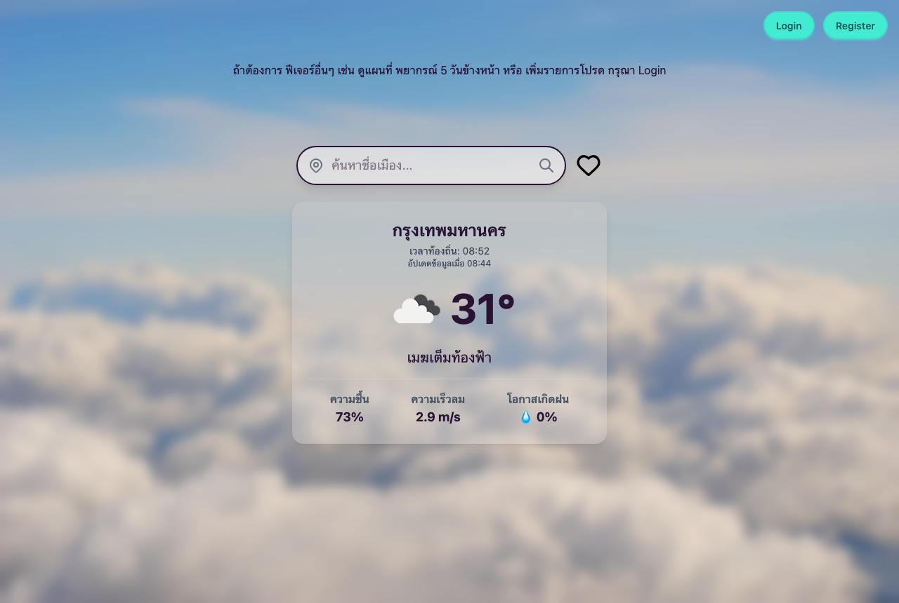

# WeatherVista — Frontend

A weather dashboard built with React. Search any city, click anywhere on the map, save favorite locations, and see a 5-day forecast — all in the city's own local time.

**Live demo:** https://weathervista-sage.vercel.app
> The API runs on Render's free tier and sleeps when idle, so the first request may take up to a minute (the app shows a notice while it wakes up).

> Backend (Express + Prisma + MySQL): [SianCS/Personal_weather_backend](https://github.com/SianCS/Personal_weather_backend)



<details>
<summary>Guest page</summary>



</details>

## Features

- **Guest mode** — search a city or use your current location without signing up
- **Interactive map** (Leaflet + OpenStreetMap) — click any point to get the weather there
- **Favorites** — save, rename and remove locations; favorites are shown as labeled markers on the map
- **5-day forecast** — 3-hour data grouped into days by the city's local time, showing daily high/low, the midday condition and the highest chance of rain
- **Local time vs. data time** — shows the city's live clock separately from when the weather data was observed, so cached data never looks "current" when it isn't
- **Auth** — register/login with form validation; expired tokens log the user out automatically

## Tech Stack

| Area | Tools |
|---|---|
| UI | React 19, Vite, Tailwind CSS 4, daisyUI |
| Routing | React Router 7 (separate routers for guests and signed-in users) |
| State | Zustand (persisted to `localStorage`) |
| Forms | React Hook Form + Yup |
| HTTP | Axios with request/response interceptors |
| Map | React Leaflet |

## Getting Started

Requires Node.js 18+ and the [backend](https://github.com/SianCS/Personal_weather_backend) running.

```bash
npm install
cp .env.example .env.local   # set VITE_API_URL if the API is not on localhost:8555
npm run dev                  # http://localhost:5173
```

| Variable | Default | Description |
|---|---|---|
| `VITE_API_URL` | `http://localhost:8555/api` | Base URL of the backend API |

## Project Structure

```
src/
├── api/          # Axios clients (public / authenticated) and API helpers
├── components/   # WeatherDisplay, FiveDayForecast, MapDisplay, CityTime, modals…
├── pages/        # GuestPage, UserDashboard, Login, Register
├── routers/      # Guest vs. user router
├── stores/       # Zustand user store
└── utils/        # Yup validation schemas
```
